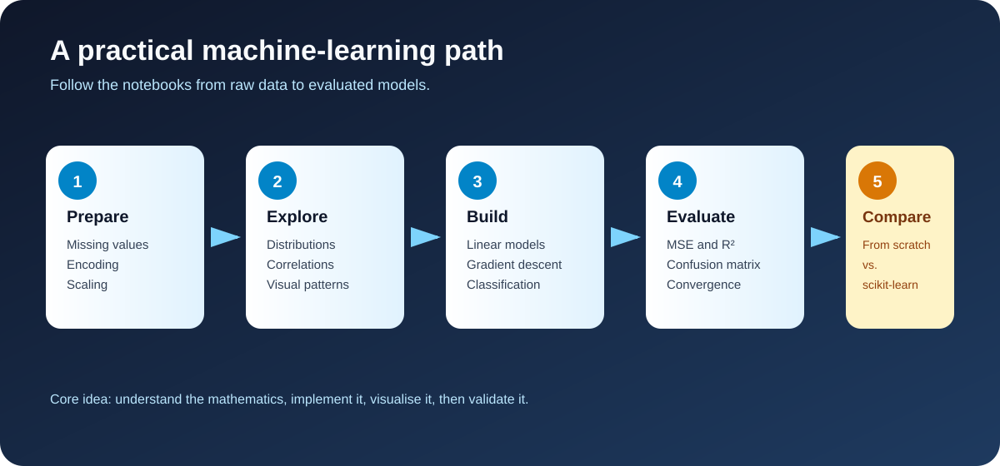
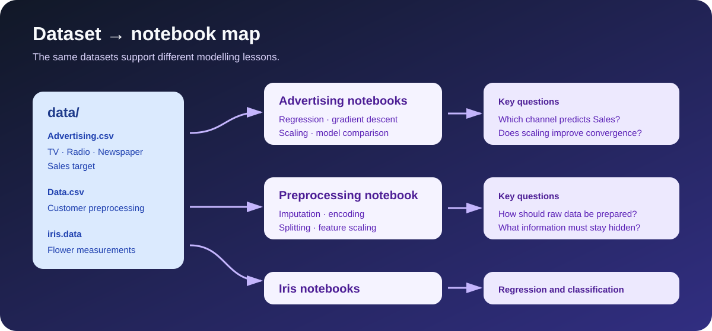

# ML Practice


Hands-on machine-learning practice covering data preparation, exploratory analysis, linear regression from scratch, gradient descent, feature scaling, and introductory classification.

The notebooks make the reasoning visible: understand the formula, implement the algorithm with NumPy, visualise what happened, and compare the result with a trusted library implementation.



## What this repository teaches

- How raw tabular data is inspected, cleaned, encoded, split, and scaled.
- How linear regression can be implemented with matrix operations.
- How gradient descent minimises a cost function step by step.
- Why feature scaling affects optimisation and convergence.
- How to evaluate regression with MSE and $R^2$.
- How to evaluate classification with accuracy, confusion matrices, and reports.
- How a from-scratch implementation compares with scikit-learn.

## Notebook map

| Notebook | Main question | Techniques |
| --- | --- | --- |
| [`data_preprocessing_workflow.ipynb`](data_preprocessing_workflow.ipynb) | How do we prepare imperfect data? | Imputation, one-hot encoding, label encoding, train/test split, Min–Max and standard scaling |
| [`advertising_linear_regression_gradient_descent.ipynb`](advertising_linear_regression_gradient_descent.ipynb) | Which single advertising channel relates to Sales? | Univariate regression, custom gradient descent, cost curves |
| [`advertising_regression_from_scratch.ipynb`](advertising_regression_from_scratch.ipynb) | How do TV, Radio, and Newspaper compare independently? | NumPy model, MSE, $R^2$, fitted-line visualisation |
| [`multiple_linear_regression_from_scratch.ipynb`](multiple_linear_regression_from_scratch.ipynb) | Can several channels predict Sales together? | Multiple regression, bias column, scikit-learn comparison |
| [`tp3_multiple_linear_regression.ipynb`](tp3_multiple_linear_regression.ipynb) | Does the hand-built model agree with a reference model? | 3D visualisation, gradient descent, MSE, $R^2$ |
| [`tp4_multiple_linear_regression_scaling.ipynb`](tp4_multiple_linear_regression_scaling.ipynb) | Why does standardisation help gradient descent? | Z-score scaling, convergence analysis, model comparison |
| [`iris_regression_gradient_descent.ipynb`](iris_regression_gradient_descent.ipynb) | Can petal width be predicted from petal length? | Simple regression on the Iris dataset |
| [`iris_classification_and_torch_regression.ipynb`](iris_classification_and_torch_regression.ipynb) | How do classical classifiers and a neural model behave? | Logistic regression, KNN, SVM, trees, MLP, PyTorch experiment |
| [`legacy_colab_experiment.ipynb`](legacy_colab_experiment.ipynb) | What did the earlier exploration look like? | Archived Colab experiments and intermediate model trials |

## Dataset mapping



| Dataset | Used for | Related notebooks |
| --- | --- | --- |
| [`data/Advertising.csv`](data/Advertising.csv) | Advertising budgets and Sales | All advertising-regression notebooks |
| [`data/Data.csv`](data/Data.csv) | Missing values and categorical variables | `data_preprocessing_workflow.ipynb` |
| [`data/iris.data`](data/iris.data) | Iris measurements and species | Iris regression and classification notebooks |
| [`data/diabetes.csv`](data/diabetes.csv) | Additional tabular practice | Available for extension |
| [`data/titanic.csv`](data/titanic.csv) | Additional classification practice | Available for extension |
| [`data/tips.csv`](data/tips.csv) | Additional exploratory-analysis practice | Available for extension |
| [`data/US-pumpkins.csv`](data/US-pumpkins.csv) | Larger mixed-type dataset | Available for extension |

## Mathematical toolkit

For a linear model, the prediction is:

$$
\hat{y}=X\theta
$$

The notebooks minimise the half mean-squared error:

$$
J(\theta)=\frac{1}{2m}\sum_{i=1}^{m}(\hat{y}^{(i)}-y^{(i)})^2
$$

The gradient-descent update is:

$$
\theta\leftarrow\theta-\alpha\frac{1}{m}X^T(X\theta-y)
$$

Regression quality is measured with MSE and the coefficient of determination:

$$
\mathrm{MSE}=\frac{1}{m}\sum_i(y_i-\hat{y}_i)^2,
\qquad
R^2=1-\frac{\sum_i(y_i-\hat{y}_i)^2}{\sum_i(y_i-\bar{y})^2}
$$

When scaling is required, standardisation uses training-set statistics only:

$$
z=\frac{x-\mu_{train}}{\sigma_{train}}
$$

## Quick start

Python 3.10+ is recommended.

```bash
python -m venv .venv
# Windows PowerShell
.venv\Scripts\Activate.ps1
# macOS/Linux
# source .venv/bin/activate
python -m pip install --upgrade pip
python -m pip install -r requirements.txt
jupyter lab
```

Run Jupyter from the repository root so paths such as `data/Advertising.csv` resolve correctly.

## Reproducibility and quality notes

- Most train/test splits use `random_state=42`.
- Dependencies are listed in [`requirements.txt`](requirements.txt).
- The PyTorch experiment automatically falls back to CPU when CUDA is unavailable.
- External hot-linked notebook images were removed; the notebooks are now portable for GitHub viewing.
- Existing outputs document the original coursework, but selected notebooks should be rerun from a clean environment before presenting results.
- Full findings and remaining technical caveats are recorded in [`docs/PROJECT_REVIEW.md`](docs/PROJECT_REVIEW.md).

## License and data note

This is a personal learning portfolio. Check the original license and attribution requirements for any dataset before redistributing it outside this repository.
